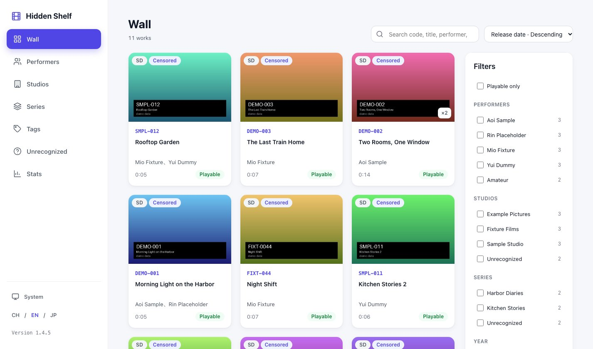
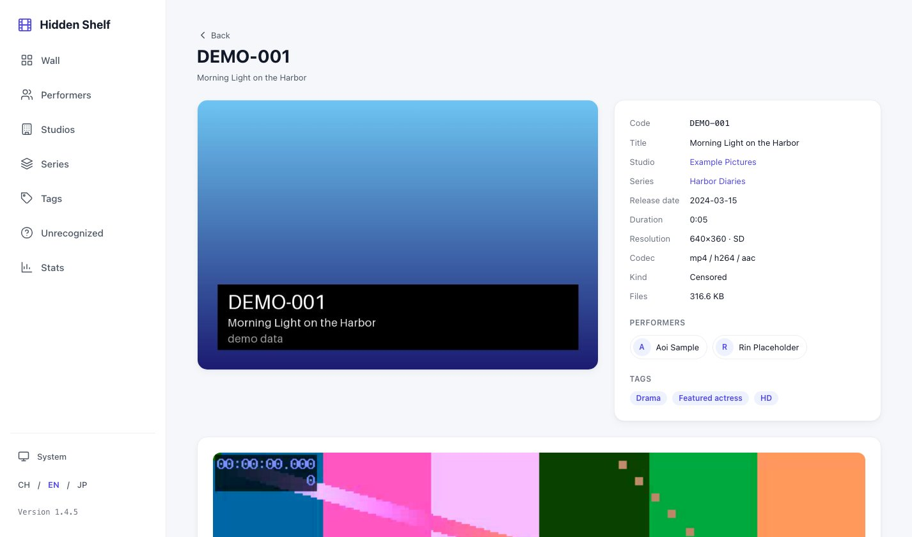
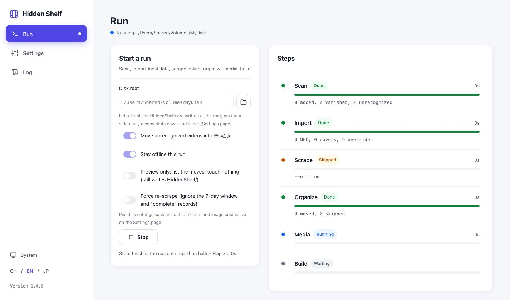
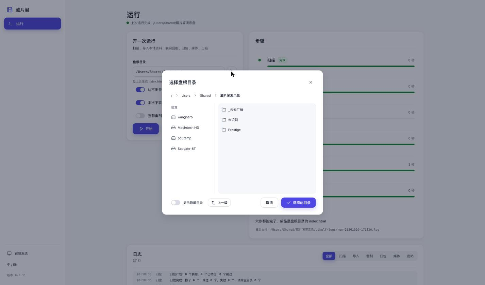

# Hidden Shelf

**Turns a hard drive full of videos into a self-describing collection.** It recognizes product codes, scrapes metadata, files everything under `studio/code/`, then writes a fully static, offline browsing site at the disk root. Every derived file lives under `HiddenShelf/` and is referenced by relative path, so after you copy the whole drive, move it to another computer, switch operating systems or restore it from a cold backup, double-clicking `index.html` still browses and plays. Nothing to install on the viewing machine.

 · [中文](README.zh.md) · [Live demo](https://wanghero.github.io/Hidden-Shelf/) (demo data; it is a demo drive published as-is to GitHub Pages)

| Poster wall | Work page |
|---|---|
|  |  |

| Progress page | Folder picker |
|---|---|
|  |  |

All screenshots use demo data; the first two are the [live demo](https://wanghero.github.io/Hidden-Shelf/).

## Core idea: the disk is the truth, the site travels with it

Most media library software keeps its knowledge in its own database: move the drive to another machine and you start over; stop using the software and all that is left is a pile of renamed files. Hidden Shelf does the opposite:

- **The disk is the single source of truth.** Once files are filed under `studio/code/`, titles, performers, tags, covers, contact sheets and the index are all written to `HiddenShelf/` at the disk root as plain files. Nothing depends on the state of the machine that ran it.
- **The site is purely static.** `index.html`, its data, images and videos use relative paths only. It opens from `file://` with no server, no database service, no network and no runtime. A phone, a TV box, a friend's laptop: anything with a browser can browse it.
- **The whole thing is portable.** Copy or move the root directory to another drive, machine or operating system and the site keeps working without a rebuild. A cold backup of the drive is a complete collection with its own catalog.
- **Organizing is repeatable.** After you move or rename files inside the collection, run `shelf run` again: it continues from the data it already has, never re-scrapes what it knows and never overwrites fields you edited by hand.
- **The program can disappear.** If you stop using Hidden Shelf one day, what remains on the disk is a tidy directory tree, an open-format `shelf.db` (SQLite), JPEGs and a web page that opens. No proprietary format.

In one sentence: organize once, and the catalog goes wherever the drive goes.

## How it differs from similar tools

| | Scrapers such as JavSP, MDCx | Desktop libraries such as Jvedio | Emby, Jellyfin, Kodi | Hidden Shelf |
|---|---|---|---|---|
| Main job | Scrape and rename, write NFO and images for a player | Manage and browse inside a desktop app | Media server or player that builds its library from NFO | Scrape, file, and write the browsing site onto the drive |
| Where the data lives | NFO and images next to the videos | The app's own database | The server's database | `HiddenShelf/` at the disk root plus a static site |
| Viewing on another machine | Install a player, rebuild the library | Install the app, re-import | The server must be online | Double-click `index.html` |
| Needs a running process | No | Yes (the desktop app) | Yes (the service) | No |

**They are not competitors, they are the previous step.** If you already organized with JavSP or MDCx, the "import local data" step reads the NFO files and covers they left behind and does not scrape again. The other way round, Hidden Shelf **does not write NFO** (next to your media it only places a copy of the cover and contact sheet, and even that can be turned off), so keep their scrapers if you still feed Emby or Jellyfin.

## What it does to your disk

One `shelf run` goes through six steps:

1. **Scan**: registers every video and its sidecars (NFO, cover, subtitles) and recognizes the product code in the file name.
2. **Import local data**: reads NFO files and covers left by earlier scrapers, plus your hand-written `HiddenShelf/overrides.json`.
3. **Scrape online**: asks the sources for title, studio, performers, tags, release date, cover and avatars where data is missing; offline it just skips, the later steps still run.
4. **Organize**: renames into `studio/code/code[-cdN].ext`; videos without a recognizable code go to `未识别/` ("unrecognized").
5. **Media**: probes duration and resolution, extracts frames for a contact sheet, uses a frame as the cover when none exists, crops a portrait poster.
6. **Build**: writes `index.html` at the disk root, an offline poster wall with filters by performer, studio and tag; click to play.

**Safety promises** (each pinned by tests):

- Only same-volume renames. **Never deletes** an original file, **never overwrites** an existing target.
- The database is backed up before every organize (last 5 kept).
- Every batch of moves is logged as JSONL (`HiddenShelf/logs/organize-*.jsonl`) and can be rolled back.
- All derived output (database, covers, posters, sheets, site data, logs, backups) lives under `HiddenShelf/`. The only thing placed next to a video is a copy of its cover and contact sheet (`images_in_work_dir`, on by default, taken back when turned off); **nothing else is written next to your media**.
- `--dry-run` shows the list first: every file that would move and every reason one would not, without touching anything.

## Install

Prerequisites: Python ≥ 3.12 and system ffmpeg/ffprobe (the media step needs them; if they are missing the run stops there and tells you how to install them).

- macOS: `brew install ffmpeg`
- Debian/Ubuntu: `sudo apt install ffmpeg`
- Windows: download from [ffmpeg.org](https://ffmpeg.org/download.html) and add `bin/` to PATH

Install the CLI (either one):

```bash
uv tool install git+https://github.com/wanghero/Hidden-Shelf
pipx install git+https://github.com/wanghero/Hidden-Shelf
```

Developers:

```bash
git clone https://github.com/wanghero/Hidden-Shelf && cd Hidden-Shelf
uv sync
uv run shelf --version
```

## Three steps

```bash
shelf run <disk root> --dry-run   # 1. preview: list only
shelf run <disk root>             # 2. the real run
open <disk root>/index.html       # 3. look at the result (Windows: double-click index.html)
```

1. **Preview**: the terminal prints "N to move, M in place, K skipped", one line `current → target` per move; past 200 lines the full list is in `HiddenShelf/logs/plan-<time>.txt`. A preview still scans, imports local data and scrapes (that is how the plan is computed, and all of it writes only to `HiddenShelf/`); nothing else on the disk is touched.
2. **Real run**: same arguments, moves exactly what the preview listed. Each step prints a one-line summary; it ends with the path of `index.html`.
3. **Result**: double-click `index.html` at the disk root. Plug the drive into another machine and it still works; every path is relative.

## Progress page

If you would rather not use the terminal, `shelf serve` starts a small web page bound to `127.0.0.1` only (default `http://127.0.0.1:8031/`; if the port is taken it tries 8000–8099, `--port` picks one, `--no-browser` does not open the browser). Enter the disk root (or click "Browse" next to it and pick with the mouse; folders that already have a library are marked), set the switches ("move unrecognized videos", "stay offline", "preview only", "force re-scrape", "copy cover and sheet next to the video") and press Start. Six step rows with status and progress, a live log, and "Open result" when done; "Stop" takes effect after the current step. The page and the CLI run the same pipeline with identical output.

## Online scraping

### Global config

Proxy and per-site cookies live in `~/.hidden-shelf/config.json` (`HIDDEN_SHELF_HOME` changes the directory); the first run writes the defaults.
Credentials live only there: never in any file on the disk, never in logs, never in snapshots. `shelf config` only reports whether a cookie is set, never its value.

```json
{
  "network": { "mode": "environment", "proxy": "" },
  "sources": {
    "javdb":  { "enabled": true, "cookie": "_jdb_session=...; over18=1" },
    "javbus": { "enabled": true, "cookie": "existmag=all" },
    "avbase": { "enabled": false, "cookie": "" }
  },
  "routes": { "censored": ["r18dev", "dmm", "javdb"] }
}
```

- `network.mode`: `environment` (follow `HTTPS_PROXY` etc.), `direct` (ignore the environment and connect directly), `proxy` (use `network.proxy`, e.g. `http://127.0.0.1:7890` or `socks5h://127.0.0.1:1080`).
- `sources.<site>.cookie`: the one-line Cookie request header copied from your browser; only javdb (quota and login wall) and javbus (age gate) need one. `enabled: false` disables a site.

If you would rather not copy cookies by hand, sign in through a browser: install Playwright once (`uv sync --extra login`, then `uv run playwright install chromium`) and run

```bash
uv run shelf login javdb      # a browser opens; sign in, then close the window or press Enter. Same for javbus
```

The "Sources & sign-in" panel in `shelf serve` does the same, with a per-site switch and a one-click "clear pause" for sites in cooldown. AVBase needs no sign-in: its Cloudflare check looks at the TLS fingerprint, so install `curl_cffi` (`uv sync --extra fingerprint`) and it passes; the panel shows whether it is installed. Cookies and the browser's User-Agent live only in the local global config, never on the disk, in logs or in snapshots.- `routes`: replaces the whole source chain for a content type. Types are `censored | amateur | uncensored | fc2`; sources are `r18dev dmm 1pondo fc2 javarchive avbase javbus javdb`. Each site is its own tier and the chain short-circuits: the first site that answers wins.

Snapshots (`<code>-<source>.json`) and cooldowns (`_cooldown.json`) live in `<disk root>/HiddenShelf/sources/`; a code is not asked again within 7 days. A 403 pauses the site for 15 minutes, doubling on repeat; a 429 honors the site's Retry-After.

### Sources

| Source | Content | Cookie needed | Smoke test on the author's machine, 2026-10-29 |
|---|---|---|---|
| r18dev | censored | no | works directly |
| dmm | censored | no | answered "no such code" for `ABW-358` |
| 1pondo | uncensored (1pondo) | no | not tested |
| fc2 | FC2 | no | works directly |
| javarchive | FC2 (delisted reposts) | no | works directly |
| javdb | censored, amateur, uncensored, FC2 | yes | works directly |
| javbus | censored, amateur, uncensored | yes (age gate) | works directly |
| avbase | censored, amateur, uncensored | no (but Cloudflare) | 403, went into cooldown; needs a browser cookie |

Default chains: censored `r18dev → dmm → avbase → javbus → javdb`; amateur `avbase → javbus → javdb → r18dev`; uncensored `1pondo → avbase → javbus → javdb`; FC2 `fc2 → javarchive → javdb`. When sources disagree, a local NFO ranks highest, then official sites, then community sites; whatever you write in `overrides.json` is never overwritten.

## Layout on the disk

```
<disk root>/
  index.html                       the result, double-click to open
  studio/code/code[-cdN].ext       organized videos (template is configurable)
  未识别/…                          unrecognized videos, original folder structure kept
  HiddenShelf/
    shelf.db                       SQLite database, the source of truth
    config.json                    per-disk settings: templates, move unrecognized, site language, scrape on/off
    overrides.json                 your manual edits, highest priority
    site/                          site data (works.js and friends)
    covers/  posters/  sheets/     covers, portrait posters, contact sheets
    avatars/                       performer avatars
    sources/                       scrape snapshots and cooldowns
    legacy/<code>/                 old NFO files and covers, kept
    logs/                          run-*.log, organize-*.jsonl, plan-*.txt
    backups/                       database backups taken before organizing (5 kept)
```

Manual edits go in `HiddenShelf/overrides.json` and are merged on the next `shelf run`:

```json
{
  "ABP-758": { "title": "Corrected title", "studio": "Prestige", "performers": ["鈴村あいり"], "tags": ["solo"] }
}
```

## FAQ

- **Does it work on another computer?** Yes. The site uses relative paths only, so the drive works wherever it is plugged in.
- **The file name is not a product code.** By default it moves to `未识别/` (keeping the original folder structure) and is listed separately on the site; `--no-move-unrecognized` leaves such files where they are.
- **NFO files and covers from an earlier scraper?** They are imported first, then moved to `HiddenShelf/legacy/<code>/`, so nothing stays next to the media.
- **Tags in Japanese or traditional Chinese?** The site shows tags in the current language (CH / EN / JP) from a built-in table of common genres; unknown tags are shown as-is. Add translations in `src/hidden_shelf/tags_i18n.py`.
- **Want the cover and contact sheet next to the video?** That is the default: `images_in_work_dir` is on (turn it off with `--no-images-in-work-dir` or the switch in the progress page). Copies of the cover and sheet from `HiddenShelf/` are placed beside the video as `<code>-cover.jpg` and `<stem>-sheet.jpg`, follow it when it is moved, and are taken back when the option is turned off; your own images are never touched.
- **Screenshots or notes left in the work's own folder?** A folder whose name carries the code counts as the work's own folder; its top-level loose files move along with the video, names unchanged, subfolders stay. The dry-run plan lists them as `EXTRA` rows.
- **A move went wrong, how do I roll back?** Each batch has `HiddenShelf/logs/organize-<time>.jsonl`. For now you call `hidden_shelf.organize.apply.rollback_batch(connection, paths, log_path)` from Python; there is no CLI entry point yet.
- **javdb wants a login.** Log in with your browser and paste the Cookie request header into `sources.javdb.cookie` in the global config.
- **The network dropped mid-run.** A scrape failure is recorded for that step only; organize, media and build still run. Run again when you are online to fill in the gaps.
- **A `.shelf/` folder from an earlier version?** Since 0.4.2 the data folder is the visible `HiddenShelf/`; the next run of any command renames it automatically. If both folders exist the run refuses and asks you to keep one.
- **The disk is read-only (NTFS on macOS is the usual case).** The run refuses up front and tells you why and what to do: install an NTFS driver or reformat as exFAT/APFS.

**I ran it on a subfolder first and now want the whole drive as the root. What happens?** The "import local data" step of the parent run finds the `HiddenShelf/` inside the subfolder and reads its titles, studios, performers, tags, covers, contact sheets and scrape history into the parent library (values the parent already has are kept), then moves the subfolder's `HiddenShelf/` and `index.html` to the parent's `HiddenShelf/legacy/nested/<subfolder>/` for safekeeping. Nothing is scraped again and no dead site is left behind. A dry run reads but does not move.

## Platforms

- macOS: verified (the author's daily driver).
- Linux: verified by CI.
- Windows: **not verified**. The CI job is allowed to fail; reports welcome.

## Disclaimer

- This tool is for adult (18+) content.
- It fetches public metadata and covers only; it does not download videos.
- No site credentials are bundled; cookies and each site's terms of use are your responsibility.
- The program is designed not to delete or overwrite and backs up before organizing, but **backups are still your job**; no liability is accepted for data loss.

## License and credits

- **AGPL-3.0-or-later**: modify and use it commercially, but a modified version offered as a network service must be open-sourced too.
- The rule modules are ported from [peach-mitao/peach](https://github.com/peach-mitao/peach) (AGPL-3.0), file by file in `docs/REUSE.md`.
- The UI follows `docs/ux-standard/`.

## Design history

- Design document: `docs/superpowers/specs/2026-10-28-hidden-shelf-design.md`
- Plan 1 (local pipeline): `docs/superpowers/plans/2026-10-28-plan-1-local-pipeline.md`
- Plan 2 (online scraping): `docs/superpowers/plans/2026-10-28-plan-2-online-scraping.md`
- Plan 3 (progress page): `docs/superpowers/plans/2026-10-29-plan-3-progress-web.md`
- Plan 4 (folder picker): `docs/superpowers/plans/2026-10-29-plan-4-folder-picker.md`
- Plan 5 (open-source prep): `docs/superpowers/plans/2026-10-29-plan-5-open-source.md`
