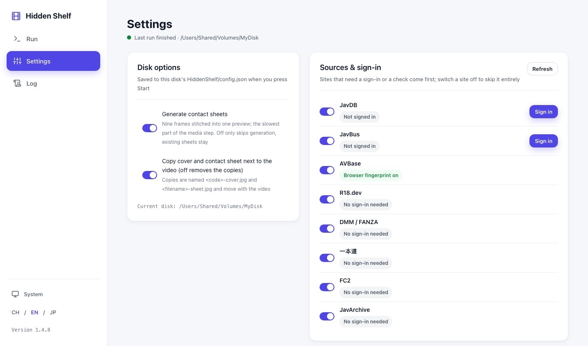

# Hidden Shelf（藏片阁）

**把一块硬盘上的影片收藏整理成「自带说明书」的整体**：认番号、联网刮削元数据、按 `厂牌/番号 标题-出演者/` 归位，然后在盘根目录生成一个纯静态、离线可用的浏览站。所有派生数据只用相对路径住在 `HiddenShelf/` 下，所以整盘复制、搬到别的电脑、换操作系统、做冷备份之后，双击 `index.html` 照样能看能播，不装任何东西。

 · [English](README.md) · [在线预览](https://wanghero.github.io/Hidden-Shelf/)（演示数据，就是把一块演示盘原样放到 GitHub Pages 上）

| 海报墙 | 作品页 |
|---|---|
|  |  |

| 进度网页 | 设置页 | 目录选择器 |
|---|---|---|
|  |  |  |

截图里都是演示数据，前两张就是[在线预览](https://wanghero.github.io/Hidden-Shelf/)。

## 核心思想：真相在盘里，站点随盘走

大多数媒体库软件把资料存在软件自己的数据库里：盘换台机器，资料就得重来；软件停止维护，整理过的东西只剩一堆改过名的文件。Hidden Shelf 反过来做：

- **盘是唯一的真相。** 文件按 `厂牌/番号 标题-出演者/` 归位之后，标题、演员、标签、封面、九宫格、索引全部写进盘根目录下的 `HiddenShelf/`，是普通文件，不依赖本机的任何状态。
- **站点是纯静态的。** `index.html` 和它引用的数据、图片、视频一律是相对路径，用 `file://` 直接打开，没有服务器、没有数据库服务、不联网、不装运行时。手机、电视盒子、别人的电脑，只要有浏览器就能看。
- **整体可搬。** 把盘根目录整个复制或移动到另一块盘、另一台机器、另一个系统，站点不用重新生成；做冷备份时备份的就是一份连同说明书的完整收藏。
- **整理可重复。** 在盘内部挪动或改名文件之后，再跑一次 `shelf run`，程序按已有资料接着做，不会重复刮削、不会覆盖你手改过的字段。
- **程序可以消失。** 哪天不再用 Hidden Shelf，盘上留下的是规整的目录、开放格式的 `shelf.db`（SQLite）、JPEG 和一个能打开的网页，不是私有格式。

一句话：整理一次，站点就跟着盘走，盘到哪里都能看。

## 和同类工具的区别

| | JavSP、MDCx 这类刮削器 | Jvedio 这类桌面库 | Emby、Jellyfin、Kodi | Hidden Shelf |
|---|---|---|---|---|
| 主要做什么 | 刮削、改名，写 NFO 和图片给播放器用 | 桌面程序里管理与浏览 | 媒体服务器或播放器，读 NFO 建库 | 刮削、归位，并把浏览站写进盘里 |
| 资料存在哪 | 视频旁边的 NFO、图片 | 软件自己的数据库 | 服务器的数据库 | 盘根 `HiddenShelf/` 加一个静态站 |
| 换台机器看 | 装播放器，重新建库 | 装软件，重新导入 | 服务器得在线 | 双击 `index.html` |
| 要不要常驻进程 | 不要 | 要（桌面程序开着） | 要（服务在跑） | 不要 |

**它们不是对手，是上一步。** 如果你已经用 JavSP、MDCx 整理过，Hidden Shelf 的「导入本地资料」步会直接读它们留下的 NFO 与封面，不重复刮削。反过来，Hidden Shelf **不写 NFO**（视频旁只放封面与九宫格的副本，这也能关掉），还要喂 Emby/Jellyfin 的话继续用它们的刮削器。

## 它会对你的盘做什么

一次 `shelf run` 走六步：

1. **扫描**：登记盘上每个视频与它旁边的附属文件（NFO、封面、字幕），认出文件名里的番号。
2. **导入本地资料**：读以前刮削器留下的 NFO 与封面，以及你手写的 `HiddenShelf/overrides.json`。
3. **联网刮削**：缺资料的番号去各站问标题、厂牌、演员、标签、发行日、封面与头像；断网就跳过，不拦后面。
4. **归位**：按 `厂牌/番号 标题-出演者/番号[-cdN].ext` 改名归位；认不出番号的视频集中到 `未识别/`。
5. **媒体**：探测时长与分辨率，抽帧做九宫格，没有封面的用抽帧兜底，裁出竖版海报。
6. **出站**：在盘根目录写 `index.html`，离线可开的海报墙，按演员、厂牌、标签筛选，点开直接播放。

**安全承诺**（都有测试钉住）：

- 只做同一卷内的改名，**绝不删除**任何原始文件，**绝不覆盖**已经存在的目标。
- 归位前自动备份数据库（保留最近 5 份）。
- 每批搬运写一份 JSONL 日志（`HiddenShelf/logs/organize-*.jsonl`），可以回滚。
- 所有派生产物（库、封面、海报、九宫格、站点数据、日志、备份）只在 `HiddenShelf/` 下。视频旁边只会多一份封面与九宫格的副本（`images_in_work_dir`，默认开，关掉就收回）；**除此之外媒体目录旁不写任何文件**。
- `--dry-run` 先看清单再动手：列出每个要搬的文件与不搬的原因，一个文件不动。

## 安装

前置：Python ≥ 3.12，以及系统 ffmpeg/ffprobe（「媒体」步要用，找不到会停在那一步并提示怎么装）。

- macOS：`brew install ffmpeg`
- Debian/Ubuntu：`sudo apt install ffmpeg`
- Windows：从 [ffmpeg.org](https://ffmpeg.org/download.html) 下载，把 `bin/` 加进 PATH

装命令行工具（二选一）：

```bash
uv tool install git+https://github.com/wanghero/Hidden-Shelf
pipx install git+https://github.com/wanghero/Hidden-Shelf
```

开发者：

```bash
git clone https://github.com/wanghero/Hidden-Shelf && cd Hidden-Shelf
uv sync
uv run shelf --version
```

## 三步上手

```bash
shelf run <盘根目录> --dry-run   # 1. 预演：只列清单
shelf run <盘根目录>             # 2. 真跑
open <盘根目录>/index.html       # 3. 看成品（Windows 双击 index.html）
```

1. **预演**：终端打出「预演：N 个要搬，M 个已就位，K 个跳过」，每个要搬的文件一行 `现路径 → 目标`，超过 200 条的完整清单在 `HiddenShelf/logs/plan-<时间>.txt`。预演会扫描、导入本地资料、联网刮削（这是算出计划的前提，都只写 `HiddenShelf/`），盘上其它地方一个文件不动。
2. **真跑**：同样的参数，搬的就是预演列出的那些。每步打一行完成摘要，结束打「成品：…/index.html」。
3. **看成品**：双击盘根目录的 `index.html`。换台电脑插上盘也能看，路径全是相对的。

## 进度网页

不想用终端就 `shelf serve`（左侧三页：「运行」填目录点开始、「设置」管盘上选项与来源登录、「日志」看每一步的输出）：在本机起一个只监听 `127.0.0.1` 的网页（默认 `http://127.0.0.1:8031/`，端口被占就在 8000–8099 内往后找，`--port` 可指定，`--no-browser` 不自动打开浏览器）。填盘根目录（或点旁边的「浏览」按钮用鼠标选，整理过的目录带「已有库」标记），几个开关：「认不出番号的视频搬到 未识别/」「本次不联网」「只预演」「强制重刮」，点「开始」；「生成九宫格」「封面与九宫格复制到视频旁」这类盘上设置在「设置」页，点开始时写进盘的 `config.json`。六步各一行状态与进度，日志实时滚动，跑完有「打开成品」；「停止」在当前步完成后生效。网页和命令行跑的是同一条流水线，输出一字不差。

## 联网刮削

### 全局配置

刮削用到的代理与各站 Cookie 放在 `~/.hidden-shelf/config.json`（环境变量 `HIDDEN_SHELF_HOME` 可改目录），第一次运行会写出默认值。
凭据只住在这里：不进盘里的任何文件、不进日志、不进快照。`shelf config` 也只说有没有，不打印值。

```json
{
  "network": { "mode": "environment", "proxy": "" },
  "sources": {
    "javdb":  { "enabled": true, "cookie": "_jdb_session=...; over18=1" },
    "javbus": { "enabled": true, "cookie": "existmag=all" },
    "avbase": { "enabled": false, "cookie": "" }
  },
  "routes": { "censored": ["r18dev", "dmm", "javdb"] }
}
```

- `network.mode`：`environment`（跟随 `HTTPS_PROXY` 等环境变量）、`direct`（忽略环境变量直连）、`proxy`（用 `network.proxy`，如 `http://127.0.0.1:7890` 或 `socks5h://127.0.0.1:1080`）。
- `sources.<站>.cookie`：浏览器里复制的一行 Cookie 请求头；只有 javdb（配额与登录墙）和 javbus（年龄门）需要。`enabled: false` 整站不问。

不想手抄 Cookie 的话，用登录功能：装一次 Playwright（`uv sync --extra login`，再 `uv run playwright install chromium`），然后

```bash
uv run shelf login javdb      # 弹出浏览器，登录完关掉窗口或按回车；javbus 同理
```

进度网页 `shelf serve` 里的「来源与登录」面板也能做同样的事，并且每站有开关、冷却中的站可以一键清除。AVBase 不用登录：它的 Cloudflare 认的是 TLS 指纹，装上 `curl_cffi`（`uv sync --extra fingerprint`）就能过，面板上会显示装没装。Cookie 与浏览器 UA 只存在本机的全局配置里，不进盘、日志和快照。
- `routes`：整条替换某类番号的来源链。内容类型 `censored | amateur | uncensored | fc2`，来源名 `r18dev dmm 1pondo tokyohot fc2 javarchive avbase javbus javdb`。每站各是一档、逐家短路：有一家答了就停。

快照（`<番号>-<来源>.json`）与来源冷却（`_cooldown.json`）在 `<盘根>/HiddenShelf/sources/`，7 天内不重问；403 首停 15 分钟连着翻倍，429 按站方说的时间。

### 来源

| 来源 | 内容类型 | 需要 Cookie | 2026-10-29 本机冒烟 |
|---|---|---|---|
| r18dev | 有码 | 否 | 直连可用 |
| dmm | 有码 | 否 | 对 `ABW-358` 回「没有这个番号」 |
| 1pondo | 无码（一本道） | 否 | 未测 |
| tokyohot | 无码（东京热：`n####`、`k####`、`red-###`） | 否 | 直连可用（2026-10-30）；给整段简介与 3762 宽封套；已下架的老作品回「没有」 |
| fc2 | FC2 | 否 | 直连可用 |
| javarchive | FC2（下架转载） | 否 | 直连可用 |
| javdb | 有码、素人、无码、FC2 | 是 | 直连可用 |
| javbus | 有码、素人、无码 | 是（年龄门） | 直连可用 |
| avbase | 有码、素人、无码 | 否（但要过 Cloudflare） | 回 403 进冷却，需要浏览器 Cookie |

默认链：有码 `r18dev → dmm → avbase → javbus → javdb`；素人 `avbase → javbus → javdb → r18dev`；无码 `1pondo → tokyohot → avbase → javbus → javdb`（1pondo 要本机证据，tokyohot 只问东京热形状的番号）；FC2 `fc2 → javarchive → javdb`。多来源分歧时本地 NFO 最高，其次官方站，社区站兜底；你在 `overrides.json` 里写的永远不被覆盖。

官方站（dmm、1pondo、tokyohot、fc2）还给整段简介，存进 `plot`，作品页「简介」栏显示。简介是顺手带的，不是重问的理由：1.4.9 之前刮过的作品要补简介，开一次「强制重刮」即可，新鲜快照直接复用，只有新来源真的联网。

## 盘上的布局

```
<盘根>/
  index.html                       成品，双击打开
  厂牌/番号 标题-出演者/番号[-cdN].ext  归位后的视频（模板可改）
  未识别/…                          认不出番号的视频，保留原目录层级
  HiddenShelf/
    shelf.db                       SQLite 库，真相在这里
    config.json                    这块盘的设置：模板、是否搬未识别、站点语言、是否联网
    overrides.json                 你手改的字段，优先级最高
    site/                          站点数据（works.js 等）
    covers/  posters/  sheets/     封面、竖版海报、九宫格
    avatars/                       演员头像
    sources/                       刮削快照与冷却
    legacy/<番号>/                  旧 NFO 与封面留底
    logs/                          run-*.log、organize-*.jsonl、plan-*.txt
    backups/                       归位前的库备份（5 份）
```

手改入口 `HiddenShelf/overrides.json`，下次 `shelf run` 自动合并：

```json
{
  "ABP-758": { "title": "改过的标题", "studio": "Prestige", "performers": ["铃村あいり"], "tags": ["单体作品"] }
}
```

## 常见问题

- **换台电脑能看吗？** 能。站点里全是相对路径，盘插哪台机器都一样。
- **文件名不是番号怎么办？** 默认搬到 `未识别/`（保留原目录层级），站点里单独列出；`--no-move-unrecognized` 可以让它们原地不动。
- **以前刮削器留下的 NFO 和封面？** 先导入，再搬到 `HiddenShelf/legacy/<番号>/` 留底，媒体目录旁不再留附属文件。
- **标签是日文或繁体，看不惯？** 站点按当前语言（CH / EN / JP）显示标签，常见类别内置了对照表；表里没有的原样显示。想补翻译改 `src/hidden_shelf/tags_i18n.py` 一张表即可。
- **九宫格太慢，能不做吗？** 能。它是媒体步最耗时的部分（每部片抽 9 帧）。盘上配置 `sheets: false`，命令行 `--no-sheets`，或进度网页「设置」页关掉「生成九宫格」；关掉只跳过生成，已有的不删，作品页没有九宫格就只显示封面。
- **不想要目录名里的标题和出演者？** 默认目录模板是 `{studio}/{code}[ {title}][-{actors}]`，给出 `Tokyo-Hot/N0900 東熱鬼畜で人生初中出し-松下栞/`；方括号里的占位符取不到值整段不出现，所以还没刮到资料的作品仍然是 `Tokyo-Hot/N0900/`，出演者超过三位只写前三位。想回到只有番号，跑一次 `shelf run <盘> --dir-template "{studio}/{code}"`，或者改这块盘 `HiddenShelf/config.json` 里的 `dir_template`。1.4.11 及之前的老盘里存的正是 `{studio}/{code}`，那是当时的默认值，读的时候会升到新默认值——真要只保留番号，把它显式写成别的（例如 `{studio}/{code}[ CD{cd}]`）。

- **想在视频旁边直接看到封面和九宫格？** 默认就是这样：`images_in_work_dir` 默认开（命令行 `--no-images-in-work-dir` 或进度网页的开关可以关掉）。程序把 `HiddenShelf/` 里的封面与九宫格复制一份到视频所在目录（`<番号>-cover.jpg`、`<主名>-sheet.jpg`），归位时跟着走，关掉选项就收回，你自己放的图片不碰。
- **作品文件夹里还有截图、说明之类的零散文件？** 文件夹名里带着这个番号的，算作品自己的文件夹，里面顶层的零散文件跟着视频一起进新目录，名字不变；子目录不动。预演清单里以 `EXTRA` 行列出。
- **搬错了怎么回滚？** 每批有 `HiddenShelf/logs/organize-<时间>.jsonl`。目前要在 Python 里调 `hidden_shelf.organize.apply.rollback_batch(connection, paths, 日志路径)`，命令行入口还没有。
- **javdb 要登录？** 浏览器登录后把 Cookie 请求头贴进全局配置的 `sources.javdb.cookie`。
- **跑一半断网？** 刮削失败只记本步，归位、媒体、出站照常；下次有网再跑一遍补资料。
- **以前版本留下的 `.shelf/`？** 0.4.2 起资料目录改名为可见的 `HiddenShelf/`，再跑一次任何命令会自动改名，不用手动搬；两个目录都在时会拒绝运行并提示保留一个。
- **盘是只读的（macOS 插 NTFS 盘最常见）？** 开跑前会直接告诉你原因与怎么办：装 NTFS 驱动或改 exFAT/APFS。

**先在某个子目录跑过，后来想以整块盘为根再跑，会怎样？** 母目录那趟的「导入本地资料」步会发现子目录里的 `HiddenShelf/`，把它的标题、厂牌、艺人、标签、封面、九宫格、刮削记录都读进母库（母库已有的值不动），然后把子目录的 `HiddenShelf/` 和 `index.html` 搬到母库的 `HiddenShelf/legacy/nested/<子目录>/` 留底。不重新刮削，不留失效的子站。预演时只读不搬。

## 平台

- macOS：已验证（作者日常使用）。
- Linux：由 CI 验证。
- Windows：**未验证**。CI 允许这一路失败，欢迎反馈。

## 免责声明

- 这是面向成年人（18+）内容的整理工具。
- 只抓公开的元数据与封面，不下载视频。
- 不内置任何站点凭据；Cookie 与各站的使用条款由你自己负责。
- 程序设计上不删、不覆盖、归位前备份，但**备份仍是你自己的事**，对数据丢失不承担责任。

## 许可与致谢

- 许可 **AGPL-3.0-or-later**：可以改、可以商用，但改过的版本拿去提供网络服务也必须开源。
- 策略模块移植自 [peach-mitao/peach](https://github.com/peach-mitao/peach)（AGPL-3.0），逐文件登记在 `docs/REUSE.md`。
- 界面规范来自 `docs/ux-standard/`。

## 设计历史

- 设计文档：`docs/superpowers/specs/2026-10-28-hidden-shelf-design.md`
- 计划 1（本地流水线）：`docs/superpowers/plans/2026-10-28-plan-1-local-pipeline.md`
- 计划 2（联网刮削）：`docs/superpowers/plans/2026-10-28-plan-2-online-scraping.md`
- 计划 3（进度网页）：`docs/superpowers/plans/2026-10-29-plan-3-progress-web.md`
- 计划 4（盘根目录鼠标选择）：`docs/superpowers/plans/2026-10-29-plan-4-folder-picker.md`
- 计划 5（开源准备）：`docs/superpowers/plans/2026-10-29-plan-5-open-source.md`
